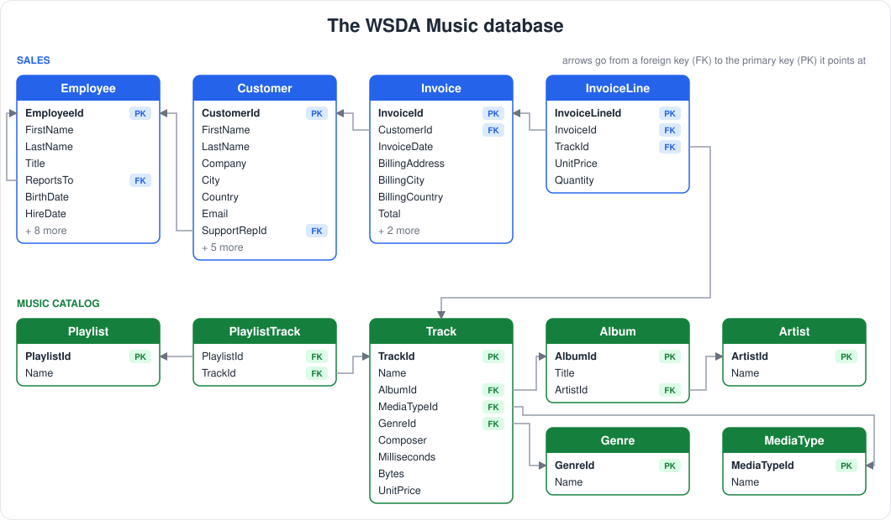
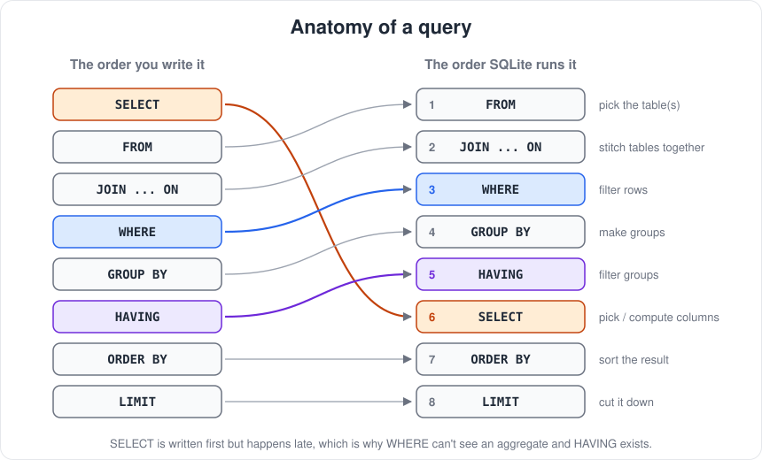
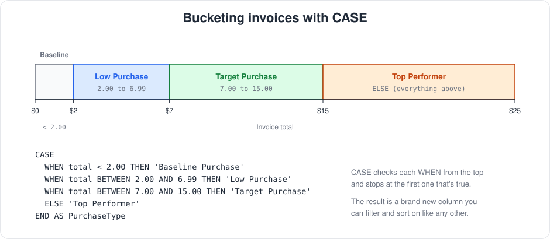
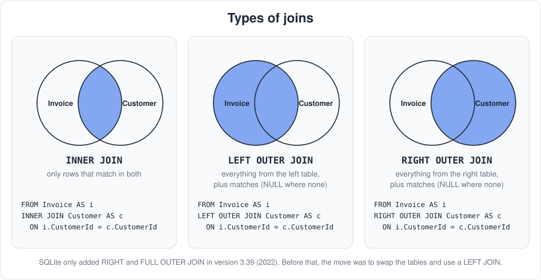
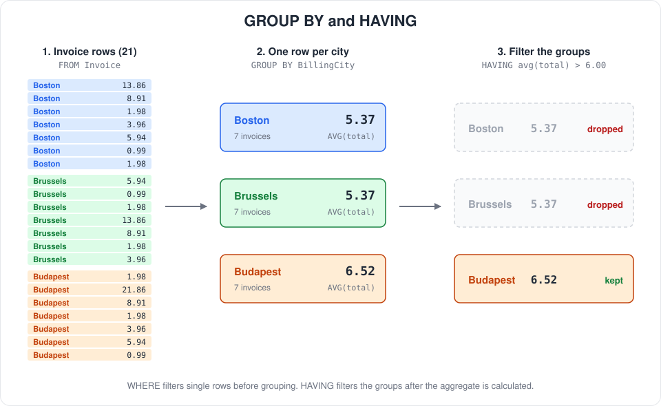
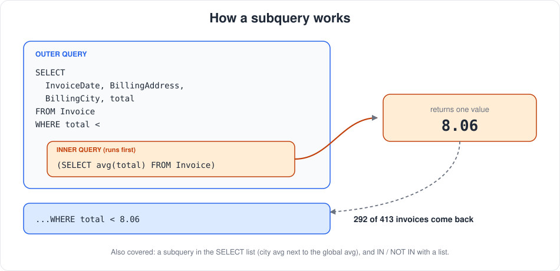
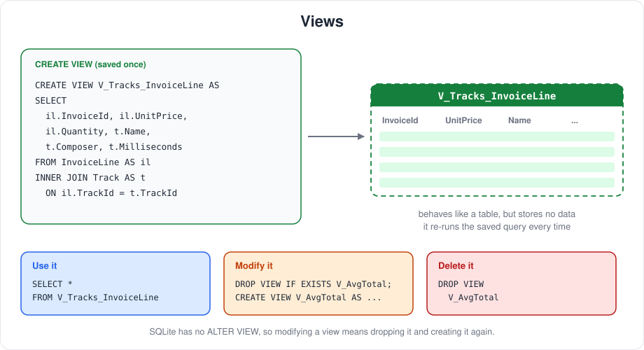
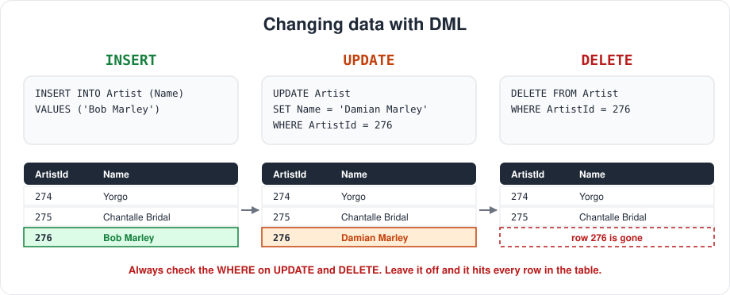

# WSDA Music - SQL Essential Training

This is my practice repo for [SQL Essential Training](https://www.linkedin.com/learning/sql-essential-training-20685933) on LinkedIn Learning, taught by Walter Shields. Everything in the course is done in SQLite against a made up music store database called WSDA Music.

## Why I'm Doing This

I've used SQL before but it's been a while, and I wanted to get my fundamentals back before I need them again. This course was a good refresher because it starts from the basics and builds up to joins, subqueries, and views, then ends with a small investigation project where you actually have to use all of it.

## Certificate

Finished the course on Nov 4, 2026. You can view my certificate of completion [here](certificate/SQL-Essential-Training-Certificate.pdf).

## What's in Here

- `Ex_Files_SQL_EssT/Exercise Files/WSDA_Music.db` - the SQLite database used in the course
- `Ex_Files_SQL_EssT/Exercise Files/WSDA_Music.sqbpro` - my DB Browser for SQLite project with the queries I wrote while following along
- `Ex_Files_SQL_EssT/Exercise Files/*.pdf` - the challenge and solution sheets for the final project
- `images/` - diagrams I put together for this README
- `certificate/` - my certificate of completion

## Tools

- SQLite
- [DB Browser for SQLite](https://sqlitebrowser.org/) to run queries and look at the tables

## The Database

Before writing any queries the course spends time on how the database is laid out. There are 11 tables split into two sides. The sales side is employees, customers, invoices, and invoice lines. The music side is tracks, albums, artists, genres, media types, and playlists. Everything connects through primary keys and foreign keys, which ends up being really important once you get to joins.



## Topics Covered

### Writing a basic query

- `SELECT` and `FROM` to pull columns out of a table
- Aliasing columns with `AS` so the output is easier to read
- Sorting with `ORDER BY` (`ASC` and `DESC`, and sorting on more than one column)
- `LIMIT` to only grab the top few rows
- Comments with `--` and `/* */`

```sql
SELECT
    FirstName AS [Customer First Name],
    LastName AS [Customer Last Name],
    Email AS EMAIL
FROM
    Customer
ORDER BY
    FirstName ASC,
    LastName DESC
LIMIT 10
```

One thing that helped me was learning the order the clauses actually run in. You write `SELECT` first, but SQLite doesn't get to it until after it's already filtered and grouped everything.



### Filtering with WHERE

- Comparison operators (`=`, `>`, `<`, `BETWEEN`)
- `IN` to match against a list of values
- `LIKE` with the `%` wildcard. My note from the course: `%` basically means "I don't care what comes next"
- Combining conditions with `AND` / `OR` and using parentheses so they get checked in the right order
- Filtering by dates

```sql
SELECT
    InvoiceDate,
    BillingAddress,
    BillingCity,
    total
FROM
    Invoice
WHERE
    total > 1.98 AND (BillingCity LIKE 'P%' OR BillingCity LIKE 'D%')
ORDER BY
    InvoiceDate
```

### CASE statements

`CASE` lets you make your own column based on conditions. In the course we used it to label every invoice by how much it was for. It checks each `WHEN` from top to bottom and uses the first one that matches.



### Joins

This was the biggest section. Since the data is spread out over multiple tables, joins are how you put it back together. We covered:

- `INNER JOIN` and how it only keeps matching rows
- `LEFT OUTER JOIN` and how it keeps everything from the left table even if there's no match
- Table aliases (`Invoice AS i`) so you're not typing the full table name every time
- Joining more than two tables at once



Here's the one that tied it together for me. It answers "which employees are responsible for the 10 highest individual sales?" by going from Invoice to Customer to Employee.

```sql
SELECT
    e.FirstName,
    e.LastName,
    e.EmployeeId,
    c.FirstName,
    c.LastName,
    c.SupportRepId,
    i.CustomerId,
    i.total
FROM
    Invoice AS i
INNER JOIN
    Customer AS c
ON
    i.CustomerId = c.CustomerId
INNER JOIN
    Employee AS e
ON
    c.SupportRepId = e.EmployeeId
ORDER BY
    i.total DESC
LIMIT 10
```

### Functions

**String functions**
- Concatenating with `||` (used it to build a full mailing address in one column)
- `LENGTH()`, `SUBSTR()`, `UPPER()`, `LOWER()`

```sql
SELECT
    FirstName || ' ' || LastName || ' ' || Address || ', ' || City || ' ' || State || ' ' || PostalCode AS [Mailing Address],
    LENGTH(PostalCode),
    SUBSTR(PostalCode, 1, 5) AS [5 Digit Postal Code],
    UPPER(FirstName) AS [First Name ALL caps],
    LOWER(LastName) AS [Last Name ALL Lower]
FROM
    Customer
WHERE
    Country = 'USA'
```

**Date functions**
- `strftime()` to format dates and strip off the time part
- Using `'now'` to calculate the age of every employee

**Aggregate functions**
- `SUM()`, `AVG()`, `MIN()`, `MAX()`, `COUNT()`
- `ROUND()` to clean up the decimals

```sql
SELECT
    SUM(total) AS [Total Sales],
    ROUND(AVG(total), 2) AS [Average Sales],
    MAX(total) AS [Maximum Sale],
    MIN(total) AS [Minimum Sale],
    COUNT(*) AS [Sales Count]
FROM
    Invoice
```

### GROUP BY and HAVING

Aggregates get a lot more useful once you group them. `GROUP BY` squishes rows into one row per group, and `HAVING` filters those groups after the math is done. The part that clicked for me is that `WHERE` filters rows before grouping and `HAVING` filters after, so you can use both in the same query.



```sql
SELECT
    BillingCity,
    ROUND(AVG(total), 2)
FROM
    Invoice
WHERE
    BillingCity LIKE 'B%'
GROUP BY
    BillingCity
HAVING
    AVG(total) > 5.00
ORDER BY
    BillingCity
```

We also grouped by more than one column (`BillingCity, BillingCountry`).

### Subqueries

A subquery is a query inside another query. The inner one runs first and hands its result to the outer one. We used them:

- In the `WHERE` clause to compare against an average
- In the `SELECT` list to show the city average next to the global average
- Without aggregates, like finding every invoice after a certain invoice's date
- With `IN` to return more than one value
- With `DISTINCT` and `NOT IN` to find tracks that have never been sold



```sql
-- Which tracks are not selling?
SELECT
    TrackId,
    Composer,
    Name
FROM
    Track
WHERE
    TrackId NOT IN (
        SELECT DISTINCT TrackId
        FROM InvoiceLine
    )
```

### Views

A view is basically a saved query that you can treat like a table. It doesn't store any data itself, it just runs the query again whenever you use it. Good for joins you keep rewriting.

- `CREATE VIEW` to make one
- Modifying a view (in SQLite this means dropping it and creating it again)
- `DROP VIEW` to delete it
- Making a view out of a join (`V_Tracks_InvoiceLine`)



### DML (changing the data)

Last topic before the project was Data Manipulation Language. Up to this point everything was read only, so this is where you actually change what's in the database.

- `INSERT INTO` to add a row
- `UPDATE` with `SET` to change a value
- `DELETE` to remove a row



Big takeaway here is to always double check your `WHERE` on an `UPDATE` or `DELETE`, because without it you're changing every single row.

## Final Project: Missing Money Matters

The course ends with a case. The manager of WSDA Music can't account for some missing money and thinks it happened between 2011 and 2012. Your job is to use SQL to come up with a list of suspects, narrow it down, and figure out who did it.

It's broken into three challenges:

1. **High level context** - how many transactions happened between 2011 and 2012 and how much money came in
2. **Targeted questions** - which customers bought something in that window, who their sales reps were, and how many transactions were above average
3. **In depth analysis** - which employees beat the average, calculating a 15% commission for each one, who made the most commission, and which of their customers looks suspicious

Pretty much every topic above shows up in it (date filtering, joins across three tables, aggregates, grouping, subqueries), which made it a good way to check that I actually understood the material. The challenge and solution PDFs are in the exercise files if you want to try it yourself. I'm not going to spoil who it was.

## Running It Yourself

1. Install [DB Browser for SQLite](https://sqlitebrowser.org/)
2. Open `Ex_Files_SQL_EssT/Exercise Files/WSDA_Music.db`
3. Go to the Execute SQL tab and start writing queries

Heads up: I ran the `INSERT` / `UPDATE` / `DELETE` and `CREATE VIEW` examples on this copy of the database, so it might not match the original course file exactly.
